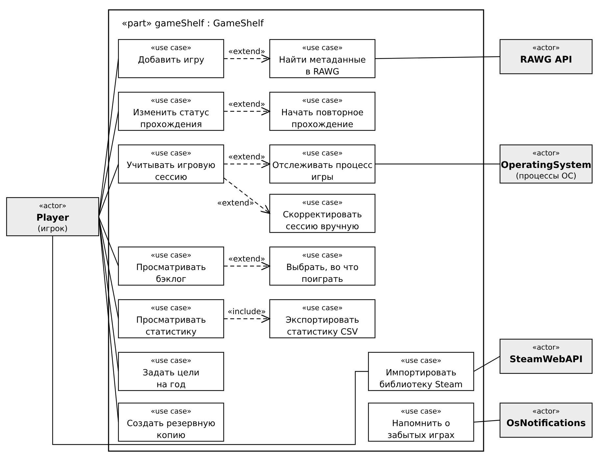
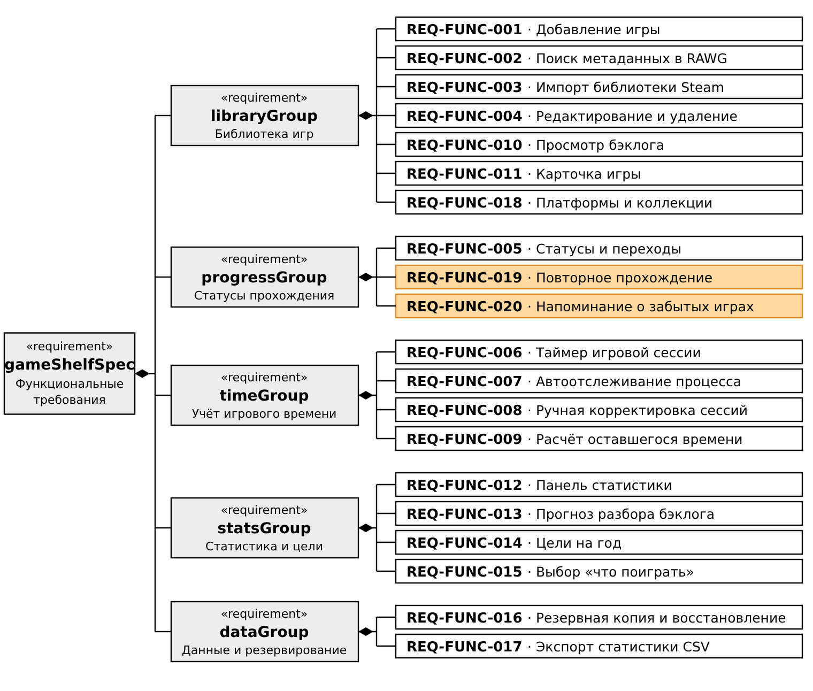
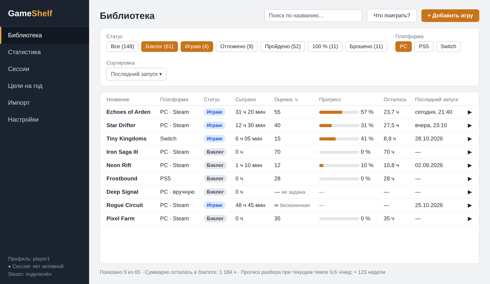
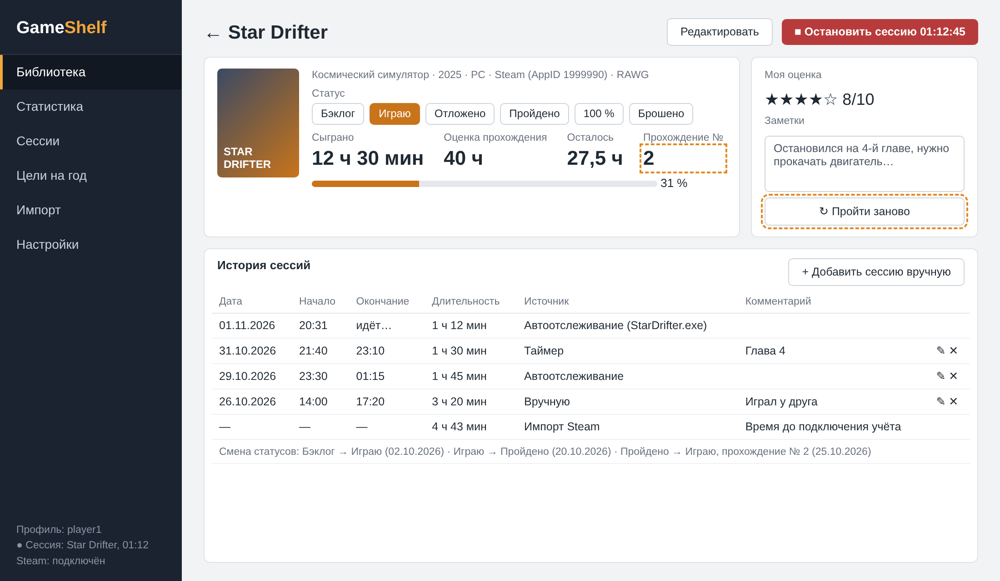
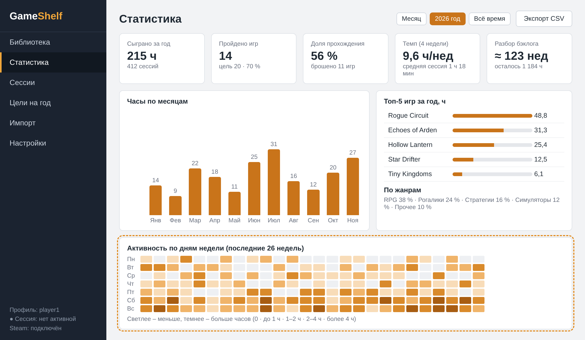
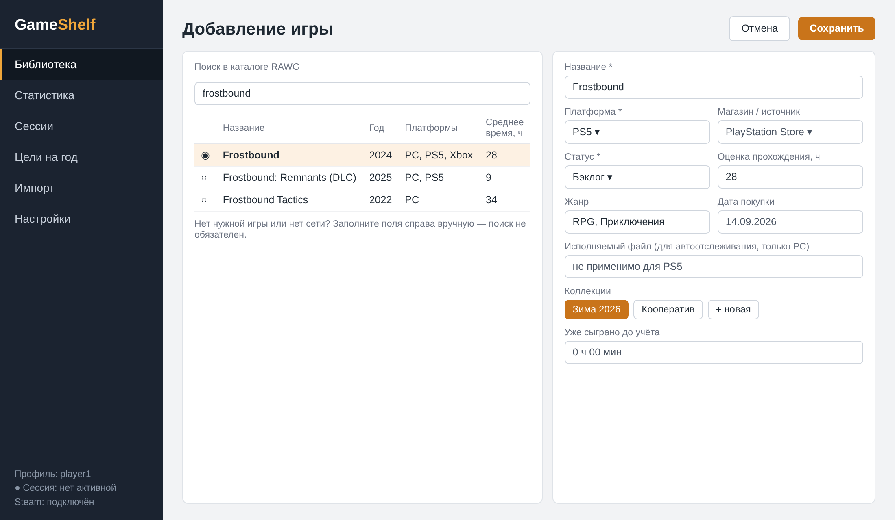
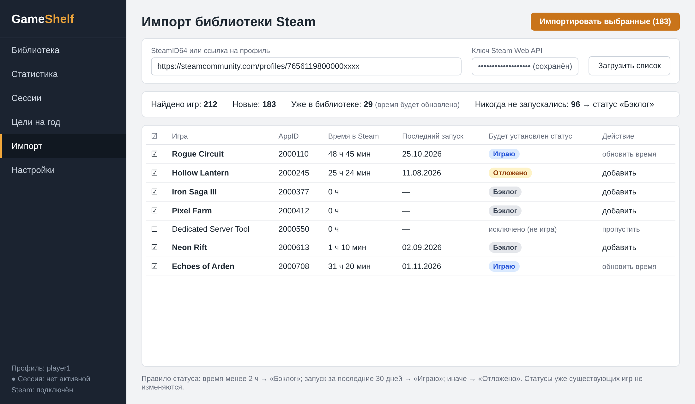
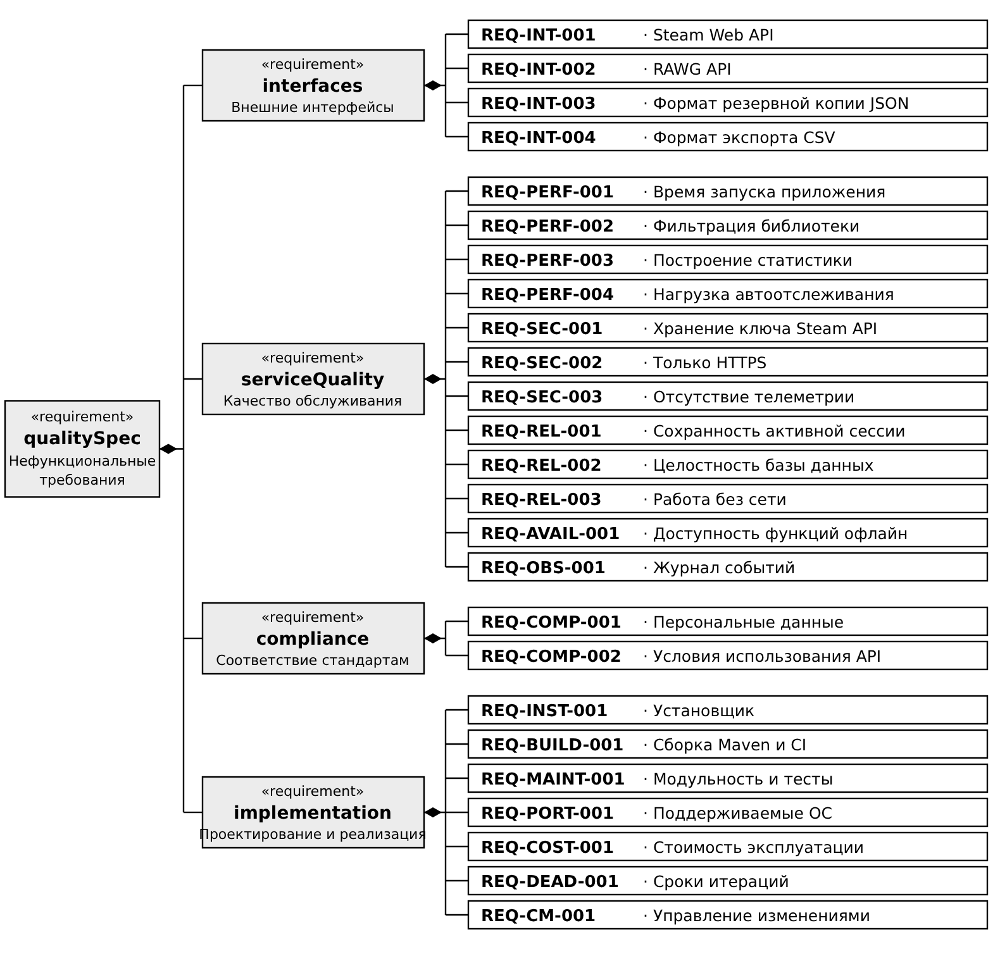
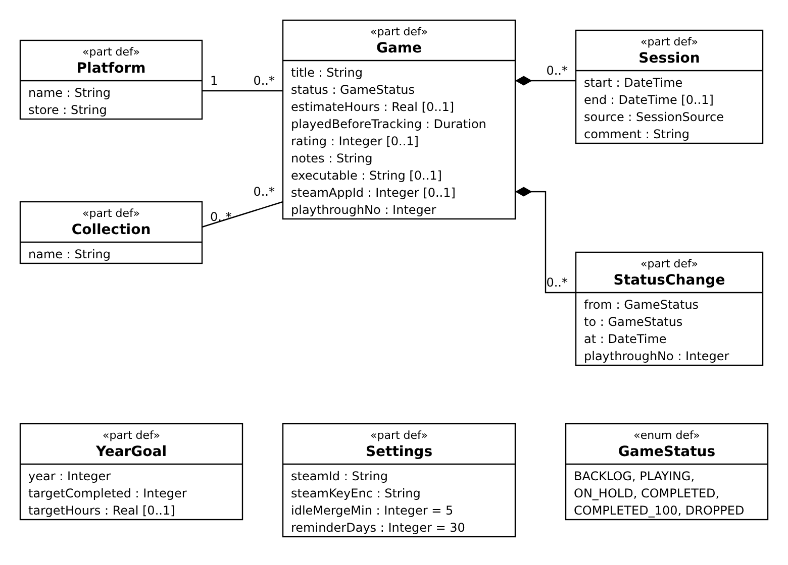

# Спецификация требований к ПО

Для GameShelf — менеджера игрового бэклога и статистики

Версия 0.2

Подготовил(а) [ФИО студента], гр. [номер группы]

БГУИР, кафедра ЭВМ

01.11.2026

## Оглавление

<!-- TOC -->
* [1. Введение](#1-introduction)
  * [1.1 Назначение документа](#11-document-purpose)
  * [1.2 Область применения продукта](#12-product-scope)
  * [1.3 Определения, акронимы и сокращения](#13-definitions-acronyms-and-abbreviations)
  * [1.4 Ссылки](#14-references)
  * [1.5 Обзор документа](#15-document-overview)
* [2. Обзор продукта](#2-product-overview)
  * [2.1 Перспектива продукта](#21-product-perspective)
  * [2.2 Функции продукта](#22-product-functions)
  * [2.3 Ограничения продукта](#23-product-constraints)
  * [2.4 Характеристики пользователей](#24-user-characteristics)
  * [2.5 Допущения и зависимости](#25-assumptions-and-dependencies)
  * [2.6 Распределение требований](#26-apportioning-of-requirements)
* [3. Требования](#3-requirements)
  * [3.1 Внешние интерфейсы](#31-external-interfaces)
    * [3.1.1 Пользовательские интерфейсы](#311-user-interfaces)
    * [3.1.2 Аппаратные интерфейсы](#312-hardware-interfaces)
    * [3.1.3 Программные интерфейсы](#313-software-interfaces)
  * [3.2 Функциональные требования](#32-functional)
  * [3.3 Качество обслуживания](#33-quality-of-service)
    * [3.3.1 Производительность](#331-performance)
    * [3.3.2 Безопасность](#332-security)
    * [3.3.3 Надёжность](#333-reliability)
    * [3.3.4 Доступность](#334-availability)
    * [3.3.5 Наблюдаемость](#335-observability)
  * [3.4 Соответствие стандартам](#34-compliance)
  * [3.5 Проектирование и реализация](#35-design-and-implementation)
    * [3.5.1 Установка](#351-installation)
    * [3.5.2 Сборка и поставка](#352-build-and-delivery)
    * [3.5.3 Распределение](#353-distribution)
    * [3.5.4 Сопровождаемость](#354-maintainability)
    * [3.5.5 Повторное использование](#355-reusability)
    * [3.5.6 Переносимость](#356-portability)
    * [3.5.7 Стоимость](#357-cost)
    * [3.5.8 Сроки](#358-deadline)
    * [3.5.9 Доказательство концепции](#359-proof-of-concept)
    * [3.5.10 Управление изменениями](#3510-change-management)
  * [3.6 ИИ/МО](#36-aiml)
* [4. Верификация](#4-verification)
* [5. Приложения](#5-appendixes)
<!-- TOC -->

## История изменений

| Name | Date | Reason For Changes | Version |
|------|------|--------------------|---------|
| [ФИО студента] | 25.10.2026 | Первая редакция по результатам интервью с заказчиком | 0.1 |
| [ФИО студента] | 01.11.2026 | Учтены замечания заказчика из pull request: добавлены REQ-FUNC-019, REQ-FUNC-020, дополнено REQ-FUNC-012; обновлены диаграммы, мокапы, модель SysML v2 и матрица верификации; отклонённые предложения внесены в приложение А | 0.2 |

---

## 1. Введение {#1-introduction}

Документ описывает требования к настольному приложению GameShelf, которое ведёт личную библиотеку компьютерных игр, учитывает статусы их прохождения и игровое время и строит по этим данным статистику. Ниже изложены назначение документа и границы продукта (раздел 1), контекст и ограничения (раздел 2), проверяемые требования (раздел 3), способы их проверки (раздел 4) и вспомогательные материалы (раздел 5).

### 1.1 Назначение документа {#11-document-purpose}

SRS фиксирует, **что** должно делать приложение GameShelf версии 1.0, и служит основой договорённости между заказчиком и командой. Документ используют: заказчик — для согласования объёма; разработчик — для проектирования и реализации; тестировщик — для подготовки тестов по идентификаторам требований; преподаватель — для оценки работ по курсу ЖЦРПО. Способ реализации здесь описывается лишь там, где он является обязательным ограничением (раздел 2.3).

### 1.2 Область применения продукта {#12-product-scope}

**GameShelf 1.0** — однопользовательское настольное приложение на Java для Windows и Linux. Оно решает задачу учёта игр, купленных в разных магазинах и на разных платформах: хранит библиотеку, статус прохождения каждой игры, автоматически и вручную учитывает игровые сессии, рассчитывает оставшееся время прохождения и прогноз разбора бэклога, показывает статистику по периодам, жанрам и дням недели.

Бизнес-цели:

| Цель | Содержание | Критерий достижения |
|------|------------|---------------------|
| БЦ-1 | Автоматизировать учёт игрового времени | Не менее 90 % времени игр на ПК за контрольную неделю зафиксировано без ручного ввода |
| БЦ-2 | Сделать бэклог управляемым | Ответ на вопросы «сколько осталось» и «во что поиграть» — не более двух действий в интерфейсе |
| БЦ-3 | Не терять данные пользователя | При аварийном завершении теряется не более 60 с текущей сессии; восстановление из резервной копии без потерь |

**Входит в версию 1.0:** библиотека игр (ручное добавление, поиск метаданных RAWG, импорт Steam); шесть статусов прохождения и повторные прохождения; таймер, автоотслеживание процесса игры и ручная корректировка сессий; расчёт оставшегося времени и прогноз разбора бэклога; статистика и цели на год; подбор игры «что поиграть»; напоминания о забытых играх; резервная копия JSON и экспорт CSV.

**Не входит:** облачная синхронизация и учётные записи, мобильное и веб-приложение, импорт из магазинов кроме Steam (Epic Games, GOG, PlayStation Network, Xbox), достижения, социальные функции, запуск игр через сторонние лаунчеры, учёт расходов на покупку игр.

### 1.3 Определения, акронимы и сокращения {#13-definitions-acronyms-and-abbreviations}

| Term | Definition |
|------|------------|
| API | Application Programming Interface — набор определений и протоколов для взаимодействия программ |
| AppID | Числовой идентификатор приложения в магазине Steam |
| RAWG | Открытая база данных о видеоиграх с публичным API (rawg.io) |
| SRS | Software Requirements Specification — документ, описывающий требования к ПО |
| SteamID64 | 64-битный идентификатор учётной записи Steam |
| UI | User Interface — пользовательский интерфейс |
| Автоотслеживание | Определение начала и окончания игровой сессии по наличию процесса игры в ОС |
| Бэклог | Множество игр в статусах «Бэклог», «Играю» и «Отложено», то есть начатых или запланированных, но не завершённых |
| Игровая сессия | Непрерывный интервал игры в одну игру с временем начала и окончания |
| Оценка прохождения | Ожидаемое число часов на прохождение игры (из RAWG или введённое пользователем) |
| Прохождение | Попытка пройти игру от начала до финала; у игры может быть несколько прохождений |
| Статус прохождения | Одно из значений: Бэклог, Играю, Отложено, Пройдено, Пройдено на 100 %, Брошено |
| Темп | Среднее игровое время в неделю за последние 28 дней, ч/нед |

### 1.4 Ссылки {#14-references}

| Документ | Владелец / версия | Расположение | Тип |
|----------|-------------------|--------------|-----|
| Шаблон SRS кафедры | BSUIR-SDLC | `srs/srs-template.md` | нормативная |
| ISO/IEC/IEEE 29148:2018 Requirements engineering | ISO | iso.org | справочная |
| Steam Web API Documentation | Valve, 2026 | https://partner.steamgames.com/doc/webapi | нормативная (REQ-INT-001) |
| RAWG Video Games Database API v1.0 | RAWG | https://api.rawg.io/docs/ | нормативная (REQ-INT-002) |
| Закон Республики Беларусь № 99-З «О защите персональных данных» | 07.05.2021 | https://pravo.by | нормативная |
| RFC 4180 — формат CSV | IETF, 2005 | https://www.rfc-editor.org/rfc/rfc4180 | нормативная (REQ-INT-004) |
| Модель требований SysML v2 | данный проект | `srs/sysml/gameshelf.sysml` | справочная |
| Прототип UI SysML v2 | данный проект | `srs/sysml/ui.sysml` | справочная |

### 1.5 Обзор документа {#15-document-overview}

Раздел 2 описывает контекст, функции, ограничения, пользователей и распределение требований по итерациям. Раздел 3 содержит требования с идентификаторами вида `REQ-[AREA]-[NNN]`, формулировкой, обоснованием, критерием приёмки и методом проверки. Раздел 4 — матрица верификации. Раздел 5 — отклонённые предложения, правила расчёта и словарь данных. Ключевые слова: «должна» — обязательное требование, «следует» — желательное, «может» — необязательное. Изменения вносятся через pull request и фиксируются в истории изменений с повышением версии.

---

## 2. Обзор продукта {#2-product-overview}

### 2.1 Перспектива продукта {#21-product-perspective}

GameShelf — новый самостоятельный продукт, не заменяющий существующую систему. Аналогичные сведения частично предоставляют клиенты магазинов (Steam показывает наигранное время), но они не знают о статусе прохождения и об играх с других платформ. GameShelf работает на компьютере пользователя, данные хранит в локальной базе SQLite и обращается к двум внешним сервисам только по явному действию пользователя (рисунок 1).

*Рисунок 1 — Участники и варианты использования (SysML v2)*

Внешние участники: **SteamWebAPI** — источник списка игр и наигранного времени; **RAWG API** — источник метаданных; **OperatingSystem** — список запущенных процессов для автоотслеживания; **OsNotifications** — системные уведомления. Владелец продукта — заказчик; SLA не применяется, поскольку приложение локальное.

### 2.2 Функции продукта {#22-product-functions}

1. Ведение библиотеки: добавление, редактирование, удаление игр, платформы и коллекции.
2. Обогащение данными: поиск метаданных в RAWG, импорт библиотеки и времени из Steam.
3. Управление статусами прохождения по матрице допустимых переходов, повторные прохождения.
4. Учёт времени: таймер, автоотслеживание процесса игры, ручная корректировка сессий.
5. Расчёт прогресса: наигранное и оставшееся время по каждой игре.
6. Статистика: часы за период, по играм, жанрам, платформам и дням недели; доля прохождения.
7. Планирование: прогноз разбора бэклога, цели на год, подбор игры по доступному времени, напоминания о забытых играх.
8. Сохранность данных: резервная копия и восстановление, экспорт CSV.

Иерархия функциональных требований показана на рисунке 2.

*Рисунок 2 — Функциональные требования (выделены добавленные в версии 0.2)*

### 2.3 Ограничения продукта {#23-product-constraints}

| ID | Ограничение | Тип |
|----|-------------|-----|
| C-1 | Приложение должно быть реализовано на Java 21 (LTS) с интерфейсом на JavaFX 21 | внешнее, обязательное (выбор курса) |
| C-2 | Данные должны храниться локально в одном файле базы SQLite в каталоге профиля пользователя | внутреннее, обязательное |
| C-3 | Приложение должно работать на Windows 10/11 x64 и Ubuntu 22.04+ x64 | внешнее, обязательное |
| C-4 | Из внешних сервисов допускаются только Steam Web API и RAWG API, оба — бесплатные | внешнее, обязательное |
| C-5 | Сборка должна выполняться Maven; схема БД — миграциями Flyway | внутреннее, предпочтительное |
| C-6 | Персональные данные не должны покидать компьютер пользователя, кроме запросов к C-4 | внешнее, обязательное (Закон № 99-З) |

### 2.4 Характеристики пользователей {#24-user-characteristics}

| Класс | Описание | Частота | Особенности |
|-------|----------|---------|-------------|
| Игрок-коллекционер | Владеет сотнями игр в нескольких магазинах, много покупает на распродажах | ежедневно, 1–5 мин | Важен импорт Steam, фильтры, прогноз бэклога |
| Игрок-«комплиционист» | Проходит игры полностью, часто перепроходит | несколько раз в неделю | Важны статусы «100 %», повторные прохождения, история |
| Казуальный игрок | Играет 2–5 ч в неделю, несколько игр одновременно | 1–2 раза в неделю | Важны автоотслеживание и напоминания, минимум ручного ввода |

Все пользователи владеют ПК на уровне уверенного пользователя. Роль одна — «Игрок» (приложение однопользовательское, аутентификация не требуется). Интерфейс — на русском языке, с возможностью добавления английской локализации; формат дат ДД.ММ.ГГГГ, десятичный разделитель — запятая.

### 2.5 Допущения и зависимости {#25-assumptions-and-dependencies}

| Допущение / зависимость | Влияние, если неверно | Мера |
|-------------------------|-----------------------|------|
| Steam Web API продолжит бесплатно отдавать список игр и время (`GetOwnedGames`) | Импорт Steam станет недоступен | Импорт — функция Should; библиотека работает без него |
| Профиль Steam пользователя открыт для чтения игровых данных | Импорт вернёт пустой список | Сообщение с инструкцией по настройке приватности |
| RAWG предоставляет бесплатный ключ (до 20 000 запросов в месяц) | Нет автоматических метаданных | Ручной ввод полей, кэш ответов |
| Имя процесса игры стабильно между запусками | Автоотслеживание не сработает | Пользователь указывает исполняемый файл вручную; ручные сессии |
| Пользователь не запускает две игры одновременно | Возможен двойной учёт | Одна активная сессия (REQ-FUNC-006) |

### 2.6 Распределение требований {#26-apportioning-of-requirements}

| Итерация | Требования | Результат |
|----------|------------|-----------|
| 1 (MVP) | REQ-FUNC-001, 004, 005, 006, 008, 009, 010, 011, 012 | Ручной учёт библиотеки, статусов и времени, базовая статистика |
| 2 | REQ-FUNC-002, 003, 007, 013, 016, 018, 019 | Интеграции, автоотслеживание, прогноз, резервные копии |
| 3 | REQ-FUNC-014, 015, 017, 020 | Цели, рекомендации, экспорт, напоминания |
| Отложено (Won't в 1.0) | Облачная синхронизация, достижения Steam (см. приложение А) | — |

Нефункциональные требования действуют во всех итерациях; REQ-PERF-004 и REQ-INT-001/002 проверяются начиная со второй.

---

## 3. Требования {#3-requirements}

Требования приведены по шаблону: ID, Title, Statement, Rationale, Acceptance Criteria, Verification Method, More Information. Приоритет указан по MoSCoW, итерация — по разделу 2.6.

### 3.1 Внешние интерфейсы {#31-external-interfaces}

#### 3.1.1 Пользовательские интерфейсы {#311-user-interfaces}

Главное окно (минимум 1100×640 пикселей) состоит из боковой панели навигации (Библиотека, Статистика, Сессии, Цели на год, Импорт, Настройки) и рабочей области. Внизу панели постоянно отображается индикатор активной сессии. Прототип интерфейса описан в нотации SysML v2 в файле [`sysml/ui.sysml`](sysml/ui.sysml); изображения экранов:

| Экран | Мокап | Требования |
|-------|-------|------------|
| Библиотека | [img/mock-library.png](img/mock-library.png) | REQ-FUNC-010, 013, 015 |
| Карточка игры | [img/mock-game.png](img/mock-game.png) | REQ-FUNC-005, 006, 008, 009, 011, 019 |
| Статистика | [img/mock-stats.png](img/mock-stats.png) | REQ-FUNC-012, 013, 014, 017 |
| Добавление игры | [img/mock-add-game.png](img/mock-add-game.png) | REQ-FUNC-001, 002, 018 |
| Импорт Steam | [img/mock-steam-import.png](img/mock-steam-import.png) | REQ-FUNC-003 |

Общие правила UI:
- пустое состояние библиотеки содержит кнопки «Добавить игру» и «Импорт из Steam»;
- ошибки внешних сервисов выводятся в неблокирующей полосе уведомления с кнопкой «Повторить»;
- горячие клавиши: Ctrl+N — добавить игру, Ctrl+F — поиск, Ctrl+Shift+S — начать/остановить сессию выбранной игры;
- все элементы доступны с клавиатуры (Tab), контраст текста не ниже 4,5:1 (WCAG 2.1, уровень AA);
- время отображается в формате «Ч ч ММ мин», часы с дробью — с одним знаком после запятой.

#### 3.1.2 Аппаратные интерфейсы {#312-hardware-interfaces}

Специальных аппаратных интерфейсов нет. Приложение использует клавиатуру, мышь и экран с разрешением от 1280×720. Игровые консоли не подключаются: время игр на консолях вводится вручную (REQ-FUNC-008).

#### 3.1.3 Программные интерфейсы {#313-software-interfaces}

- **ID:** REQ-INT-001
- **Title:** Интеграция со Steam Web API
- **Statement:** Система должна получать список игр пользователя и наигранное время методом `IPlayerService/GetOwnedGames/v1` (параметры `include_appinfo=1`, `include_played_free_games=1`) по HTTPS с ключом пользователя; таймаут запроса — 10 с, не более 3 повторов с паузой 2, 4, 8 с.
- **Rationale:** Основной источник библиотеки для пользователей ПК (БЦ-1).
- **Acceptance Criteria:** На тестовом профиле из 212 игр загружаются все 212 записей; при ответе 401/403 выводится сообщение «Неверный ключ или закрытый профиль»; при недоступности сервиса интерфейс не блокируется.
- **Verification Method:** Test
- **More Information:** Ограничение C-4; документация Steam Web API.

- **ID:** REQ-INT-002
- **Title:** Интеграция с RAWG API
- **Statement:** Система должна выполнять поиск игр методом `GET /api/games?search=` и получать карточку `GET /api/games/{id}` (название, год, жанры, платформы, обложка, `playtime`) с частотой не более 1 запроса в секунду; ответы кэшируются на 30 дней.
- **Rationale:** Заполнение метаданных и оценки прохождения без ручного ввода.
- **Acceptance Criteria:** Поиск «frostbound» возвращает список за ≤ 3 с при доступной сети; повторный запрос той же карточки в течение 30 дней не обращается к сети; в окне «О программе» и на экране поиска присутствует ссылка на RAWG.
- **Verification Method:** Test
- **More Information:** REQ-COMP-002.

- **ID:** REQ-INT-003
- **Title:** Формат резервной копии
- **Statement:** Резервная копия должна быть файлом JSON в UTF-8 с полем `formatVersion` и полными данными игр, сессий, истории статусов, коллекций, целей и настроек (без ключа Steam API).
- **Rationale:** Переносимость данных между компьютерами и версиями (БЦ-3).
- **Acceptance Criteria:** Экспорт → удаление БД → импорт дают идентичные данные (сравнение выгрузок совпадает побайтно, кроме даты создания).
- **Verification Method:** Test

- **ID:** REQ-INT-004
- **Title:** Формат экспорта CSV
- **Statement:** Экспорт CSV должен соответствовать RFC 4180, кодировка UTF-8 с BOM, разделитель «;», даты ISO-8601, длительность в минутах.
- **Rationale:** Открытие в Excel/LibreOffice без настройки.
- **Acceptance Criteria:** Файл открывается в Excel и LibreOffice Calc с корректной кириллицей и разбиением по столбцам.
- **Verification Method:** Demonstration

### 3.2 Функциональные требования {#32-functional}

#### Библиотека игр

- **ID:** REQ-FUNC-001
- **Title:** Добавление игры
- **Statement:** Система должна позволять добавить игру с обязательными полями «Название» (1–200 символов) и «Платформа» и необязательными: статус (по умолчанию «Бэклог»), оценка прохождения (0,5–1000 ч или «бесконечная»), жанры, дата покупки, исполняемый файл, коллекции, время, сыгранное до начала учёта.
- **Rationale:** Базовая операция ведения библиотеки; консольные и сторонние игры добавляются только так.
- **Acceptance Criteria:** Игра с корректными полями появляется в библиотеке; при пустом названии кнопка «Сохранить» недоступна и поле подсвечено; при совпадении названия и платформы с существующей игрой выводится предупреждение о дубликате с возможностью продолжить.
- **Verification Method:** Test
- **More Information:** Приоритет Must, итерация 1. Мокап `img/mock-add-game.png`.

- **ID:** REQ-FUNC-002
- **Title:** Поиск метаданных в RAWG
- **Statement:** При добавлении и редактировании игры система должна предлагать поиск по названию в RAWG и по выбору результата заполнять жанры, год, обложку и оценку прохождения (поле `playtime`, если оно больше 0). Пользователь может изменить любое заполненное поле.
- **Rationale:** Сокращает ручной ввод, даёт оценку прохождения для расчётов.
- **Acceptance Criteria:** Выбор результата заполняет поля; при отсутствии сети показывается сообщение, а форма остаётся доступной для ручного ввода.
- **Verification Method:** Test
- **More Information:** Should, итерация 2. REQ-INT-002.

- **ID:** REQ-FUNC-003
- **Title:** Импорт библиотеки Steam
- **Statement:** Система должна по SteamID64 (или ссылке на профиль) и ключу API загружать список игр, показывать предпросмотр и импортировать выбранные игры. Для новых игр статус задаётся правилом: наигранное время < 2 ч → «Бэклог»; последний запуск ≤ 30 дней назад → «Играю»; иначе → «Отложено». Время Steam записывается как сессия с источником «Импорт Steam». Для существующих игр (совпадение AppID) обновляется только импортированное время, статус не меняется.
- **Rationale:** Быстрое наполнение библиотеки (БЦ-1); повторный импорт не должен портить данные.
- **Acceptance Criteria:** Повторный импорт того же профиля не создаёт дубликатов; импортированное время равно `playtime_forever` из ответа API; инструменты и серверы (не игры) по умолчанию сняты с выбора.
- **Verification Method:** Test
- **More Information:** Should, итерация 2. Мокап `img/mock-steam-import.png`.

- **ID:** REQ-FUNC-004
- **Title:** Редактирование и удаление игры
- **Statement:** Система должна позволять изменить любые поля игры и удалить игру вместе с её сессиями и историей после подтверждения в диалоге.
- **Rationale:** Исправление ошибок ввода.
- **Acceptance Criteria:** После удаления игра и её сессии отсутствуют в библиотеке и статистике; отмена в диалоге ничего не меняет.
- **Verification Method:** Test
- **More Information:** Must, итерация 1.

- **ID:** REQ-FUNC-010
- **Title:** Просмотр бэклога
- **Statement:** Система должна показывать список игр со столбцами: название, платформа, статус, сыграно, оценка, прогресс, осталось, последний запуск; поддерживать множественный фильтр по статусу, платформе и коллекции, поиск по подстроке без учёта регистра и сортировку по любому столбцу. Внизу списка выводится сумма оставшихся часов и прогноз разбора (REQ-FUNC-013). Выбор фильтров сохраняется между запусками.
- **Rationale:** Главный экран приложения (БЦ-2).
- **Acceptance Criteria:** На наборе из 148 игр фильтр «Бэклог + Играю» показывает ровно игры этих статусов; счётчики на кнопках фильтров соответствуют числу игр.
- **Verification Method:** Test
- **More Information:** Must, итерация 1. Мокап `img/mock-library.png`.

- **ID:** REQ-FUNC-011
- **Title:** Карточка игры
- **Statement:** Система должна показывать по игре: метаданные, текущий статус с переключателем, сыгранное и оставшееся время, номер прохождения, оценку пользователя (1–10), заметки (до 5000 символов), историю сессий и историю смены статусов с датами.
- **Rationale:** Полная информация по игре в одном месте.
- **Acceptance Criteria:** Сумма длительностей сессий в истории равна значению «Сыграно»; каждая смена статуса отражается в истории с датой.
- **Verification Method:** Inspection, Test
- **More Information:** Must, итерация 1. Мокап `img/mock-game.png`.

- **ID:** REQ-FUNC-018
- **Title:** Платформы и коллекции
- **Statement:** Система должна вести справочник платформ (по умолчанию PC, PS5, PS4, Xbox Series, Switch) с возможностью добавления, и пользовательские коллекции (теги); игра принадлежит одной платформе и любому числу коллекций.
- **Rationale:** Группировка и фильтрация больших библиотек.
- **Acceptance Criteria:** Нельзя удалить платформу, к которой привязаны игры (выводится число таких игр); удаление коллекции не удаляет игры.
- **Verification Method:** Test
- **More Information:** Should, итерация 2.

#### Статусы прохождения

- **ID:** REQ-FUNC-005
- **Title:** Статусы прохождения и допустимые переходы
- **Statement:** Система должна поддерживать статусы: Бэклог, Играю, Отложено, Пройдено, Пройдено на 100 %, Брошено, и разрешать только переходы из таблицы 5.2 (приложение Б). При начале сессии у игры в статусе Бэклог, Отложено или Брошено статус автоматически становится «Играю». Каждый переход сохраняется в истории с датой и номером прохождения.
- **Rationale:** Статус — ключевое понятие продукта, отсутствующее в клиентах магазинов; запрет бессмысленных переходов сохраняет корректность статистики.
- **Acceptance Criteria:** Все 36 пар «из → в» проверены тестом: разрешённые выполняются, запрещённые отклоняются с сообщением, статус не меняется.
- **Verification Method:** Test
- **More Information:** Must, итерация 1.

- **ID:** REQ-FUNC-019
- **Title:** Повторное прохождение
- **Statement:** Для игры в статусе «Пройдено» или «Пройдено на 100 %» система должна позволять начать повторное прохождение: номер прохождения увеличивается на 1, статус становится «Играю», оставшееся время считается только по сессиям нового прохождения, а суммарное время и история прежних прохождений сохраняются. При запуске сессии пройденной игры система спрашивает: «Начать повторное прохождение?» или «Записать сессию без смены статуса».
- **Rationale:** Замечание заказчика: перепрохождения любимых игр не должны искажать статистику первого прохождения.
- **Acceptance Criteria:** После повторного прохождения игры (40 ч оценки, 42 ч в первом прохождении) показано: прохождение № 2, сыграно в текущем 0 ч, осталось 40 ч, всего 42 ч; в статистике «Пройдено игр» игра учитывается один раз за каждое завершённое прохождение в периоде.
- **Verification Method:** Test
- **More Information:** Should, итерация 2. Добавлено в версии 0.2.

- **ID:** REQ-FUNC-020
- **Title:** Напоминание о забытых играх
- **Statement:** Система может раз в сутки при запуске проверять игры в статусе «Играю», не запускавшиеся N дней (по умолчанию 30, настраивается 7–365 или отключается), и показывать системное уведомление со списком до 3 таких игр и предложением сменить статус на «Отложено» или «Брошено».
- **Rationale:** Замечание заказчика: начатые и забытые игры засоряют статус «Играю».
- **Acceptance Criteria:** При последнем запуске игры 31 день назад и N = 30 уведомление показывается один раз в сутки; при отключённой настройке не показывается.
- **Verification Method:** Test
- **More Information:** Could, итерация 3. Добавлено в версии 0.2.

#### Учёт игрового времени

- **ID:** REQ-FUNC-006
- **Title:** Таймер игровой сессии
- **Statement:** Система должна запускать и останавливать сессию кнопкой в карточке игры, в библиотеке (▶) или горячей клавишей; одновременно может быть активна только одна сессия (запуск второй останавливает первую с подтверждением). Активная сессия показывается в боковой панели с отсчётом времени. Сессии короче 60 с не сохраняются.
- **Rationale:** Учёт времени для игр, которые нельзя отследить автоматически (консоли, эмуляторы).
- **Acceptance Criteria:** Сессия 19:00–21:30 сохраняется с длительностью 2 ч 30 мин; сессия 45 с не сохраняется; при попытке запустить вторую сессию выводится подтверждение.
- **Verification Method:** Test
- **More Information:** Must, итерация 1.

- **ID:** REQ-FUNC-007
- **Title:** Автоматическое отслеживание процесса игры
- **Statement:** Система следует, пока работает (в том числе свёрнутой в системный трей), раз в 5 с проверять список процессов ОС; при появлении процесса с исполняемым файлом игры начинать сессию с источником «Автоотслеживание», при его исчезновении — завершать. Если тот же процесс появляется снова не позднее чем через 5 мин (настраивается 0–30 мин), сессия продолжается.
- **Rationale:** Основной механизм достижения БЦ-1.
- **Acceptance Criteria:** Процесс завершён в 20:00, перезапущен в 20:04 → одна сессия; перерыв 7 мин → две сессии; погрешность границ сессии ≤ 10 с.
- **Verification Method:** Test
- **More Information:** Should, итерация 2. REQ-PERF-004.

- **ID:** REQ-FUNC-008
- **Title:** Ручная корректировка сессий
- **Statement:** Система должна позволять добавить сессию с датой, временем начала и окончания или длительностью, изменить и удалить любую завершённую сессию. Сессии одной игры не должны пересекаться по времени: при пересечении выводится ошибка.
- **Rationale:** Исправление ошибок автоотслеживания, учёт игр вне компьютера.
- **Acceptance Criteria:** Сессия 23:30–01:15 сохраняется длительностью 1 ч 45 мин; добавление сессии, пересекающейся с существующей, отклоняется.
- **Verification Method:** Test
- **More Information:** Must, итерация 1.

- **ID:** REQ-FUNC-009
- **Title:** Расчёт наигранного и оставшегося времени
- **Statement:** Система должна рассчитывать по каждой игре: суммарное время (все сессии и время до учёта), время текущего прохождения T_факт и оставшееся время T_ост = max(0; T_оц − T_факт), прогресс = min(100; round(100 × T_факт / T_оц)) %. Для пройденных игр прогресс равен 100 %; для игр без оценки и «бесконечных» оставшееся время и прогресс не выводятся. Сессия, пересекающая полночь, при расчёте статистики по дням делится на части по календарным суткам.
- **Rationale:** Основа прогноза и статистики (БЦ-2).
- **Acceptance Criteria:** T_оц = 40, T_факт = 12,5 → T_ост = 27,5 ч, прогресс 31 %; T_оц = 20, T_факт = 26 → T_ост = 0, прогресс 100 %; сессия 23:30–01:15 даёт 30 мин в первый день и 1 ч 15 мин во второй.
- **Verification Method:** Test
- **More Information:** Must, итерация 1. Правила расчёта — приложение Б.

#### Статистика и цели

- **ID:** REQ-FUNC-012
- **Title:** Панель статистики
- **Statement:** Система должна показывать за выбранный период (месяц, год, всё время): сыграно часов и число сессий; число пройденных игр; долю прохождения K = 100 × N_пр / (N_пр + N_бр); темп за последние 28 дней; среднюю длительность сессии; диаграмму часов по месяцам; топ-5 игр; распределение по жанрам и платформам; тепловую карту активности по дням недели за последние 26 недель.
- **Rationale:** Пользователь видит, сколько и во что он играет.
- **Acceptance Criteria:** На контрольном наборе данных все показатели совпадают с ручным расчётом; тепловая карта для недели с 5 ч игры в субботу окрашивает ячейку в самый тёмный цвет (> 4 ч).
- **Verification Method:** Test
- **More Information:** Must, итерация 1. Тепловая карта добавлена в версии 0.2. Мокап `img/mock-stats.png`.

- **ID:** REQ-FUNC-013
- **Title:** Прогноз разбора бэклога
- **Statement:** Система следует рассчитывать прогноз D = ΣT_ост / v (недель), где сумма берётся по играм в статусах Бэклог, Играю, Отложено с известной оценкой, а v — темп (часов за последние 28 дней / 4). Результат округляется до целого; при v = 0 выводится «прогноз не определён»; число игр без оценки выводится отдельно.
- **Rationale:** Наглядно показывает масштаб бэклога (БЦ-2).
- **Acceptance Criteria:** ΣT_ост = 1184 ч, за 28 дней 38,4 ч → v = 9,6 ч/нед, D ≈ 123 недели.
- **Verification Method:** Test
- **More Information:** Should, итерация 2.

- **ID:** REQ-FUNC-014
- **Title:** Цели на год
- **Statement:** Система может хранить цель на календарный год (число пройденных игр, необязательно — число часов) и показывать прогресс выполнения в процентах.
- **Rationale:** Мотивация разбирать бэклог.
- **Acceptance Criteria:** Цель 20 игр, пройдено 14 → 70 %.
- **Verification Method:** Test
- **More Information:** Could, итерация 3.

- **ID:** REQ-FUNC-015
- **Title:** Выбор «что поиграть»
- **Statement:** Система может по кнопке «Что поиграть?» и введённому доступному времени (в часах) предложить до 3 игр из статусов Бэклог и Отложено, у которых T_ост не превышает введённое время, отсортированных по убыванию оценки пользователя, затем по дате покупки; кнопка «Другие варианты» показывает следующие 3.
- **Rationale:** Помогает начать игру из бэклога вместо покупки новой.
- **Acceptance Criteria:** При доступных 10 ч игра с T_ост = 12 ч не предлагается; при отсутствии подходящих игр выводится сообщение.
- **Verification Method:** Test
- **More Information:** Could, итерация 3.

#### Данные и резервирование

- **ID:** REQ-FUNC-016
- **Title:** Резервная копия и восстановление
- **Statement:** Система следует создавать резервную копию по команде и автоматически раз в неделю (хранятся 5 последних), а также восстанавливать данные из файла с предварительной проверкой `formatVersion` и созданием копии текущей базы.
- **Rationale:** БЦ-3; перенос на другой компьютер.
- **Acceptance Criteria:** См. REQ-INT-003; при файле неверного формата данные не изменяются, выводится ошибка.
- **Verification Method:** Test
- **More Information:** Should, итерация 2.

- **ID:** REQ-FUNC-017
- **Title:** Экспорт статистики CSV
- **Statement:** Система может экспортировать в CSV список игр и список сессий за выбранный период.
- **Rationale:** Анализ данных во внешних инструментах.
- **Acceptance Criteria:** Число строк в файле сессий равно числу сессий за период; формат — REQ-INT-004.
- **Verification Method:** Test
- **More Information:** Could, итерация 3.

### 3.3 Качество обслуживания {#33-quality-of-service}

Измерения производительности выполняются на эталонном ПК: 4 ядра, 8 ГБ ОЗУ, SSD, Windows 11, тестовая база из 5000 игр и 50 000 сессий.

#### 3.3.1 Производительность {#331-performance}

- **ID:** REQ-PERF-001 — **Title:** Время запуска — **Statement:** От запуска до отображения библиотеки должно проходить не более 3 с (холодный старт — не более 5 с). — **Rationale:** Приложение открывают на короткое время. — **Acceptance Criteria:** Медиана 10 замеров ≤ 3 с. — **Verification Method:** Test
- **ID:** REQ-PERF-002 — **Title:** Фильтрация библиотеки — **Statement:** Применение фильтра, поиска или сортировки на 5000 играх должно занимать не более 300 мс. — **Rationale:** Отзывчивость главного экрана. — **Acceptance Criteria:** 95-й процентиль 100 замеров ≤ 300 мс. — **Verification Method:** Test
- **ID:** REQ-PERF-003 — **Title:** Построение статистики — **Statement:** Панель статистики по 50 000 сессий должна строиться не более чем за 1 с. — **Rationale:** REQ-FUNC-012. — **Acceptance Criteria:** 95-й процентиль ≤ 1 с. — **Verification Method:** Test
- **ID:** REQ-PERF-004 — **Title:** Нагрузка автоотслеживания — **Statement:** Фоновое автоотслеживание должно потреблять в среднем не более 1 % CPU и не более 150 МБ ОЗУ при свёрнутом окне. — **Rationale:** Не мешать играм. — **Acceptance Criteria:** Замер за 1 ч игры. — **Verification Method:** Analysis

#### 3.3.2 Безопасность {#332-security}

- **ID:** REQ-SEC-001 — **Title:** Хранение ключа Steam API — **Statement:** Ключ Steam Web API должен храниться в зашифрованном виде (AES-256-GCM, ключ шифрования — в хранилище ОС: Windows Credential Manager / Secret Service), не выводиться в интерфейс полностью и не попадать в журналы и резервные копии. — **Rationale:** Ключ даёт доступ к данным учётной записи. — **Acceptance Criteria:** Поиск строки ключа в файле БД, журналах и копиях не находит совпадений. — **Verification Method:** Inspection, Test
- **ID:** REQ-SEC-002 — **Title:** Защищённые соединения — **Statement:** Все обращения к внешним сервисам должны выполняться только по HTTPS (TLS 1.2+) с проверкой сертификата. — **Rationale:** Защита ключей при передаче. — **Acceptance Criteria:** При подмене сертификата запрос отклоняется. — **Verification Method:** Test
- **ID:** REQ-SEC-003 — **Title:** Отсутствие телеметрии — **Statement:** Приложение не должно передавать данные пользователя никуда, кроме запросов REQ-INT-001/002, выполняемых по действию пользователя. — **Rationale:** Ограничение C-6. — **Acceptance Criteria:** Анализ сетевого трафика за 1 ч работы без импорта и поиска — 0 исходящих соединений. — **Verification Method:** Analysis

#### 3.3.3 Надёжность {#333-reliability}

- **ID:** REQ-REL-001 — **Title:** Сохранность активной сессии — **Statement:** Время окончания активной сессии должно записываться в БД не реже раза в 60 с; после аварийного завершения при следующем запуске незавершённая сессия закрывается по последней записи. — **Rationale:** БЦ-3. — **Acceptance Criteria:** Принудительное завершение процесса через 10 мин игры → сохранено ≥ 9 мин. — **Verification Method:** Test
- **ID:** REQ-REL-002 — **Title:** Целостность базы — **Statement:** Изменения должны выполняться в транзакциях SQLite (режим WAL); при обнаружении повреждения БД при запуске пользователю предлагается восстановление из последней резервной копии. — **Rationale:** БЦ-3. — **Acceptance Criteria:** Обрыв процесса во время импорта не оставляет частично импортированных игр. — **Verification Method:** Test
- **ID:** REQ-REL-003 — **Title:** Отказ внешних сервисов — **Statement:** Недоступность или ошибка Steam/RAWG не должна блокировать интерфейс или приводить к потере введённых данных; запросы выполняются в фоновом потоке. — **Rationale:** Сервисы вне контроля команды. — **Acceptance Criteria:** При отключённой сети форма добавления игры сохраняется. — **Verification Method:** Test

#### 3.3.4 Доступность {#334-availability}

- **ID:** REQ-AVAIL-001 — **Title:** Работа без сети — **Statement:** Все функции, кроме импорта Steam и поиска RAWG, должны быть доступны без подключения к интернету. — **Rationale:** Локальное приложение. — **Acceptance Criteria:** Сценарий приёмки итерации 1 выполняется при отключённой сети. — **Verification Method:** Demonstration

#### 3.3.5 Наблюдаемость {#335-observability}

- **ID:** REQ-OBS-001 — **Title:** Журнал событий — **Statement:** Приложение должно вести журнал (SLF4J + Logback) уровней INFO/WARN/ERROR с ротацией: 5 файлов по 10 МБ в каталоге профиля; фиксируются запуск, ошибки, начало и окончание сессий, обращения к API (без ключей и SteamID). — **Rationale:** Разбор ошибок, присланных пользователем. — **Acceptance Criteria:** Журнал не превышает 50 МБ; ключи и SteamID отсутствуют. — **Verification Method:** Inspection

### 3.4 Соответствие стандартам {#34-compliance}

- **ID:** REQ-COMP-001 — **Title:** Персональные данные — **Statement:** Приложение должно хранить SteamID и игровую активность только на компьютере пользователя и удалять все данные по команде «Удалить профиль» в настройках. — **Rationale:** Закон РБ № 99-З, ограничение C-6. — **Acceptance Criteria:** После команды каталог профиля пуст. — **Verification Method:** Test
- **ID:** REQ-COMP-002 — **Title:** Условия использования API — **Statement:** Приложение должно соблюдать условия Steam Web API (не более 100 000 вызовов в сутки, ключ пользователя) и RAWG (ссылка-атрибуция на RAWG рядом с данными, не более 20 000 запросов в месяц). — **Rationale:** Лицензионные условия сервисов. — **Acceptance Criteria:** Атрибуция присутствует; счётчик запросов RAWG не превышает лимит. — **Verification Method:** Inspection

### 3.5 Проектирование и реализация {#35-design-and-implementation}

#### 3.5.1 Установка {#351-installation}

- **ID:** REQ-INST-001 — **Title:** Установщик — **Statement:** Приложение должно поставляться установщиками MSI (Windows) и DEB (Ubuntu), собранными jpackage, со встроенной средой выполнения Java; установка не требует прав администратора (установка для пользователя), удаление сохраняет данные профиля, если не выбрано иное. — **Acceptance Criteria:** Установка на чистую ОС без Java завершается за ≤ 2 мин. — **Verification Method:** Demonstration

#### 3.5.2 Сборка и поставка {#352-build-and-delivery}

- **ID:** REQ-BUILD-001 — **Title:** Сборка Maven и CI — **Statement:** Проект должен собираться командой `mvn verify`; на каждый pull request в GitHub Actions выполняются сборка, тесты и проверка покрытия; версии зависимостей фиксированы, артефакты релиза публикуются в GitHub Releases с контрольными суммами SHA-256. — **Acceptance Criteria:** PR без зелёной сборки не сливается. — **Verification Method:** Inspection

#### 3.5.3 Распределение {#353-distribution}

Не применяется: приложение работает на одном компьютере, распределённых компонентов нет.

#### 3.5.4 Сопровождаемость {#354-maintainability}

- **ID:** REQ-MAINT-001 — **Title:** Модульность и тесты — **Statement:** Код должен быть разделён на слои (UI JavaFX — сервисы предметной области — доступ к данным — интеграции); логика статусов и учёта времени не зависит от JavaFX и покрыта модульными тестами JUnit 5 не менее чем на 80 % строк (JaCoCo). — **Acceptance Criteria:** Отчёт JaCoCo ≥ 80 % для пакетов `progress` и `timetracking`. — **Verification Method:** Analysis

#### 3.5.5 Повторное использование {#355-reusability}

Модули `timetracking` (учёт сессий и правила объединения) и `integration.steam` оформляются отдельными модулями Maven без зависимости от UI, чтобы их можно было использовать в будущих версиях (например, в консольной утилите).

#### 3.5.6 Переносимость {#356-portability}

- **ID:** REQ-PORT-001 — **Title:** Поддерживаемые ОС — **Statement:** Приложение должно работать на Windows 10/11 x64 и Ubuntu 22.04/24.04 x64; платформенно-зависимый код (получение списка процессов, хранилище секретов, уведомления) изолирован за интерфейсами. macOS не поддерживается в версии 1.0. — **Acceptance Criteria:** Сценарий приёмки проходит на обеих ОС. — **Verification Method:** Demonstration

#### 3.5.7 Стоимость {#357-cost}

- **ID:** REQ-COST-001 — **Title:** Стоимость эксплуатации — **Statement:** Эксплуатация не должна требовать платных сервисов и серверов (0 USD в месяц); используются только бесплатные API и библиотеки с открытыми лицензиями (Apache 2.0, MIT, EPL). — **Verification Method:** Inspection

#### 3.5.8 Сроки {#358-deadline}

- **ID:** REQ-DEAD-001 — **Title:** Сроки итераций — **Statement:** Итерация 1 (MVP) — до конца ноября 2026 г., итерация 2 — до середины декабря 2026 г., итерация 3 — до конца семестра; каждая итерация завершается демонстрацией заказчику. — **Verification Method:** Inspection

#### 3.5.9 Доказательство концепции {#359-proof-of-concept}

Перед итерацией 2 проверяется осуществимость автоотслеживания через `ProcessHandle.allProcesses()` (Java 9+) на Windows и Linux: критерий успеха — определение запуска и завершения 5 тестовых игр с погрешностью ≤ 10 с и нагрузкой ≤ 1 % CPU. При неуспехе REQ-FUNC-007 пересматривается (например, опрос через системные утилиты).

#### 3.5.10 Управление изменениями {#3510-change-management}

- **ID:** REQ-CM-001 — **Title:** Управление изменениями — **Statement:** Изменения требований вносятся через pull request в ветку `main` с рецензией заказчика; каждое изменение фиксируется в истории изменений с повышением версии (дополнение — +0.1, ломающее изменение — +1.0); схема БД меняется только миграциями Flyway с сохранением обратной совместимости резервных копий. — **Verification Method:** Inspection

### 3.6 ИИ/МО {#36-aiml}

Не применяется: GameShelf 1.0 не использует моделей машинного обучения. Подбор «что поиграть» (REQ-FUNC-015) выполняется детерминированным правилом.

---

## 4. Верификация {#4-verification}

На текущем этапе реализация не начата, все строки имеют статус «Запланировано». Тестовые артефакты будут размещены в каталоге `tests/` репозитория.

| Requirement ID | Verification Method | Test/Artifact Link | Status | Evidence |
|----------------|---------------------|--------------------|--------|----------|
| REQ-FUNC-001 | Test | tests/UC01-add-game.md | Запланировано | |
| REQ-FUNC-002 | Test | tests/UC02-rawg.md | Запланировано | |
| REQ-FUNC-003 | Test | tests/UC03-steam-import.md | Запланировано | |
| REQ-FUNC-004 | Test | tests/UC04-edit-delete.md | Запланировано | |
| REQ-FUNC-005 | Test | StatusTransitionTest (36 пар) | Запланировано | |
| REQ-FUNC-006 | Test | SessionTimerTest | Запланировано | |
| REQ-FUNC-007 | Test | ProcessWatcherTest, tests/UC07-auto.md | Запланировано | |
| REQ-FUNC-008 | Test | ManualSessionTest | Запланировано | |
| REQ-FUNC-009 | Test | PlaytimeCalculatorTest (приложение Б) | Запланировано | |
| REQ-FUNC-010 | Test | tests/UC10-backlog.md | Запланировано | |
| REQ-FUNC-011 | Inspection, Test | tests/UC11-game-card.md | Запланировано | |
| REQ-FUNC-012 | Test | StatisticsServiceTest | Запланировано | |
| REQ-FUNC-013 | Test | BacklogForecastTest | Запланировано | |
| REQ-FUNC-014 | Test | YearGoalTest | Запланировано | |
| REQ-FUNC-015 | Test | WhatToPlayTest | Запланировано | |
| REQ-FUNC-016 | Test | BackupRoundTripTest | Запланировано | |
| REQ-FUNC-017 | Test | CsvExportTest | Запланировано | |
| REQ-FUNC-018 | Test | tests/UC18-collections.md | Запланировано | |
| REQ-FUNC-019 | Test | ReplayTest | Запланировано | |
| REQ-FUNC-020 | Test | ReminderTest | Запланировано | |
| REQ-INT-001 | Test | SteamClientIT (WireMock) | Запланировано | |
| REQ-INT-002 | Test | RawgClientIT (WireMock) | Запланировано | |
| REQ-INT-003 | Test | BackupRoundTripTest | Запланировано | |
| REQ-INT-004 | Demonstration | tests/csv-demo.md | Запланировано | |
| REQ-PERF-001 | Test | perf/startup.md | Запланировано | |
| REQ-PERF-002 | Test | perf/filter-bench (JMH) | Запланировано | |
| REQ-PERF-003 | Test | perf/stats-bench (JMH) | Запланировано | |
| REQ-PERF-004 | Analysis | perf/tracker-cpu.md | Запланировано | |
| REQ-SEC-001 | Inspection, Test | security/secret-scan.md | Запланировано | |
| REQ-SEC-002 | Test | TlsTest | Запланировано | |
| REQ-SEC-003 | Analysis | security/traffic-capture.md | Запланировано | |
| REQ-REL-001 | Test | CrashRecoveryTest | Запланировано | |
| REQ-REL-002 | Test | ImportAtomicityTest | Запланировано | |
| REQ-REL-003 | Test | OfflineTest | Запланировано | |
| REQ-AVAIL-001 | Demonstration | tests/offline-demo.md | Запланировано | |
| REQ-OBS-001 | Inspection | checklist/logging.md | Запланировано | |
| REQ-COMP-001 | Test | DeleteProfileTest | Запланировано | |
| REQ-COMP-002 | Inspection | checklist/api-terms.md | Запланировано | |
| REQ-INST-001 | Demonstration | tests/install.md | Запланировано | |
| REQ-BUILD-001 | Inspection | .github/workflows/ci.yml | Запланировано | |
| REQ-MAINT-001 | Analysis | Отчёт JaCoCo | Запланировано | |
| REQ-PORT-001 | Demonstration | tests/os-matrix.md | Запланировано | |
| REQ-COST-001 | Inspection | checklist/licenses.md | Запланировано | |
| REQ-DEAD-001 | Inspection | План итераций | Запланировано | |
| REQ-CM-001 | Inspection | История изменений SRS | Запланировано | |

Иерархия нефункциональных требований:

---

## 5. Приложения {#5-appendixes}

### Приложение А. Отклонённые предложения заказчика

| Предложение | Решение | Обоснование |
|-------------|---------|-------------|
| Синхронизация библиотеки между ПК и телефоном через облако | Отклонено (Won't в 1.0) | Требует серверной части, учётных записей и хостинга, что противоречит ограничениям C-2, C-6 и REQ-COST-001; перенос между компьютерами решается резервной копией (REQ-FUNC-016) |
| Загрузка достижений Steam и расчёт прогресса по ним | Отклонено (Won't в 1.0) | Достижения не отражают прохождение сюжета, у многих игр их нет или они не связаны с прогрессом; для оценки прогресса достаточно оценки времени (REQ-FUNC-009); возможно в следующих версиях |

### Приложение Б. Правила расчёта и переходы статусов

**Формулы.**

- Оставшееся время: T_ост = max(0; T_оц − T_факт), где T_факт — время текущего прохождения (для первого прохождения включает время, сыгранное до учёта).
- Прогноз разбора бэклога: D = ΣT_ост / v, v = (часы за последние 28 дней) / 4.
- Доля прохождения: K = 100 × N_пр / (N_пр + N_бр), где N_пр — игры, завершённые в статусах «Пройдено» и «Пройдено на 100 %», N_бр — брошенные.

**Таблица 5.2 — Допустимые переходы статусов** («+» — разрешён, «а» — выполняется автоматически при начале сессии, «п» — только через повторное прохождение REQ-FUNC-019, «–» — запрещён):

| Из \ В | Бэклог | Играю | Отложено | Пройдено | 100 % | Брошено |
|--------|--------|-------|----------|----------|-------|---------|
| Бэклог | – | + / а | + | + | – | + |
| Играю | + | – | + | + | + | + |
| Отложено | + | + / а | – | + | – | + |
| Пройдено | – | п | – | – | + | – |
| 100 % | – | п | – | – | – | – |
| Брошено | + | + / а | – | – | – | – |

**Контрольные примеры** — см. критерии приёмки REQ-FUNC-006 – REQ-FUNC-009, REQ-FUNC-013.

### Приложение В. Модель предметной области

Текстовая модель (требования, части системы, связи «удовлетворяет», варианты использования): [`sysml/gameshelf.sysml`](sysml/gameshelf.sysml). Прототип интерфейса: [`sysml/ui.sysml`](sysml/ui.sysml). Исходники диаграмм: [`sysml/diagrams.py`](sysml/diagrams.py), исходники мокапов: [`mockups/`](mockups/).
